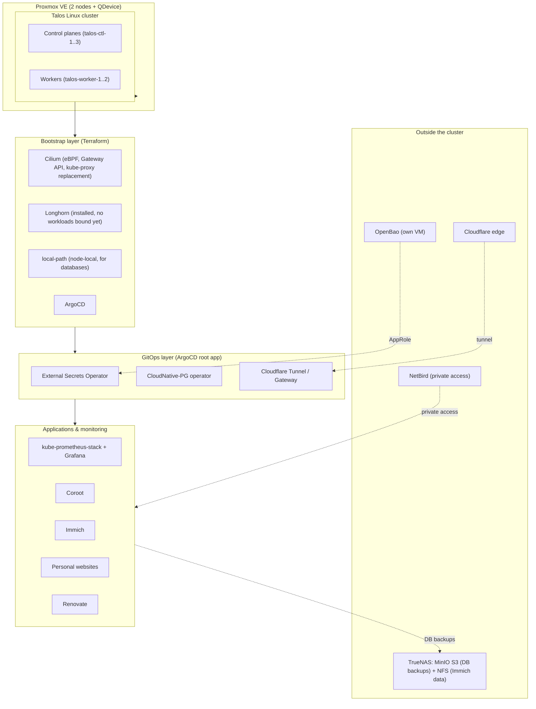
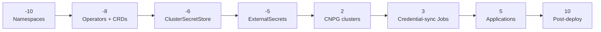

# Talos + Proxmox Kubernetes Homelab

[](https://www.talos.dev/)
[](https://kubernetes.io/)
[](https://argo-cd.readthedocs.io/)
[](https://cilium.io/)
[](https://longhorn.io/)
[](https://cloudnative-pg.io/)
[](https://www.terraform.io/)
[](https://openbao.org/)

A five-node Talos Linux Kubernetes cluster on a two-node Proxmox VE cluster. I built it to practise platform engineering end to end: Terraform provisioning, an immutable OS, eBPF networking, GitOps with ArgoCD, secrets kept out of Git, and database backups I can restore.

**This is a learning environment that I operate with production habits. It is not a production system.** It is one site with one operator and no SLOs. The [Known limitations](#️-known-limitations) section sits near the top on purpose: I would rather you read my gaps from me than find them yourself.

**Jump to:** [At a glance](#-at-a-glance) · [Architecture](#-architecture) · [Decisions](#-key-decisions) · [Limitations](#️-known-limitations) · [Backups & DR](#-backups--disaster-recovery) · [Bootstrap](#-bootstrap-guide) · [Roadmap](#-roadmap)

> The repository has been renamed to `Talos-Proxmox-Homelab`. It was originally `Talos-KubeSpan-Homelab` from when one control-plane node lived in the cloud and used KubeSpan. All nodes are now local and KubeSpan is no longer used. Private access is handled by NetBird (see [Networking and exposure](#-networking-and-exposure)).

---

## 📌 At a glance

| | |
| :--- | :--- |
| **Cluster** | 3 control planes + 2 workers on 2 Proxmox nodes + a QDevice. Versions are in the badges above. |
| **Environments** | One cluster. The `staging` overlay is what runs today. A `production` overlay exists but is **not deployed**. The plan is to shrink this cluster to a single control plane as a test bed and build a separate production cluster from the same layout. |
| **GitOps** | ArgoCD app-of-apps, Kustomize overlays, sync policy auto / selfHeal / prune |
| **Databases** | One CloudNative-PG cluster per app that needs Postgres. WAL and base backups go to MinIO (S3) on my TrueNAS. |
| **Secrets** | OpenBao (outside the cluster) → External Secrets Operator → Kubernetes Secrets. No plaintext secrets in Git. |
| **Networking** | Cilium (kube-proxy replacement, Gateway API, LB IPAM). Public websites via Cloudflare Tunnel (CFGate). Private apps via NetBird. No inbound ports are open. |
| **Workloads** | Immich (the only app used by friends and family), personal websites, Minecraft, Authentik, Renovate, Prometheus/Grafana, Coroot |
| **Restore drills** | Full cluster rebuild from Terraform + Git with databases restored from S3 (November 19 2026). Not every layer has been drilled. See [Backups & DR](#-backups--disaster-recovery) and the [DR plan](docs/disaster-recovery.md). |

---

## 🏛 Architecture



**Two layers by design.** Terraform builds only what ArgoCD needs before it can take over: VMs, Talos, Cilium, ArgoCD (Longhorn is also installed here). Everything after that is reconciled from Git.

### Design principles

- **Immutable OS.** Talos has no SSH and no shell. Node configuration is an API call, defined in `.talos/patches`.
- **Git is the source of truth.** ArgoCD reconciles the cluster from this repo.
- **No application secrets in Git.** `ExternalSecret` manifests are pointers and the values live in OpenBao. A few bootstrap credentials are the exception (see [limitations](#️-known-limitations)).
- **Match storage to failure model.** Databases replicate at the application layer (CNPG), so they get fast node-local disks and don't pay for replication twice.
- **Rebuild over repair.** For the cluster itself I prefer rebuilding from code to restoring etcd, and I keep durable state (databases, secrets, personal data) outside the cluster. This trade-off is explained in the [DR plan](docs/disaster-recovery.md#decision-etcd-is-not-backed-up).

---

## 🧭 Key decisions

| Decision | Chosen | Alternative considered | Why | Trade-off I accepted |
| :--- | :--- | :--- | :--- | :--- |
| OS | Talos Linux | Ubuntu + kubeadm / k3s | Immutable, API-driven, minimal attack surface, config as data | Harder to debug; no SSH |
| CNI | Cilium (eBPF) | Flannel / Calico | kube-proxy replacement, Gateway API, LB IPAM, path to network policy and flow visibility | More moving parts; no policies written yet |
| DB storage | `local-path` + CNPG | Longhorn for DBs | CNPG already replicates, so this avoids replication-on-replication and extra write load, and gives higher IOPS | Each instance's data is pinned to one node's disk |
| General storage | Longhorn (installed, unused today) | NFS / Ceph | Replicated block storage with snapshots and S3 backups, for when I have stateful apps that need it | Only 2 workers, so at most 2 replicas |
| Large media storage | NFS from TrueNAS (ZFS) | Longhorn | Immich needs a lot of capacity, and ZFS already gives snapshots and replication | TrueNAS is a single point of failure for Immich data |
| Secrets | OpenBao + ESO | Sealed Secrets / SOPS | One central store outside the cluster, so secrets survive a cluster rebuild and aren't encrypted-in-Git | OpenBao is a dependency I also operate and must back up |
| GitOps | ArgoCD app-of-apps + sync waves | Flux | UI for seeing sync state and diffs while learning; widely used | Sync-wave ordering needs care (see below) |
| Public ingress | Cloudflare Tunnel + Gateway API | Port-forward + reverse proxy | No inbound ports opened on my network | Cloudflare is in the trust path |
| Private access | NetBird (WireGuard mesh) + Caddy | Public ingress with auth | Friends and family reach Immich over a private mesh instead of the internet | Users must install a client |
| Bootstrap | Terraform up to ArgoCD, then hand over | Everything in Terraform | One tool owns each layer | Two sources of truth to keep consistent |
| Cluster backup | No etcd snapshots; rebuild from code | Scheduled `talosctl etcd snapshot` | Nothing in etcd is irreplaceable: manifests are in Git, data is in S3 and OpenBao | Slower recovery from partial control-plane loss. Revisit if that matters. |

---

## ⚠️ Known limitations

I would not run this for other people yet. Here are the gaps, why they exist and what I plan to do about them.

### Security

| Limitation | Impact | Plan |
| :--- | :--- | :--- |
| **No network policies.** Cilium is installed but I have not written any `NetworkPolicy` / `CiliumNetworkPolicy`. The pod network is flat. | Any pod can reach any other pod, including PostgreSQL. A compromised workload could move laterally. Exposure is limited because nothing is port-forwarded and public traffic comes only through the Cloudflare Tunnel. | Hubble is enabled but I have not used it yet. Observe real flows first, then default-deny the database and secrets namespaces, then expand outward. |
| **Terraform state is unencrypted.** It is stored on my NAS and contains bootstrap credentials (ArgoCD repo access, S3 keys) and Talos secrets. | Anyone who can read the NAS path can read those secrets. | Move to OpenTofu and use its native state encryption. Reduce the bootstrap secret set to the OpenBao AppRole only. |
| **ESO's AppRole `secret_id` never expires** (`secret_id_ttl=0`) and was created by hand. | A leaked secret ID stays valid until I revoke it. No rotation process exists. | TTL-bound secret ID with a rotation job. The token is already restricted by CIDR. |
| **OpenBao is configured by hand.** The `bao` commands below are not code. | Policies and auth config are not reviewable in Git and could drift. | Codify them with the Vault provider (OpenTofu/Terraform). |
| **Public surface is small but not audited.** Only the personal websites are exposed, through Cloudflare Tunnel. | A tunnel misconfiguration would expose the website namespace. | Review the exposed routes and the Authentik coverage; add a short exposure checklist. |

### Reliability

| Limitation | Impact | Plan |
| :--- | :--- | :--- |
| **Two Proxmox hosts + QDevice.** Three control planes cannot spread evenly across two hosts, so one host carries two of them. | Losing that host loses etcd quorum and the API server. Workloads keep running; changes stop. Because I don't snapshot etcd, recovery means a full rebuild. | Documented in the [DR plan](docs/disaster-recovery.md). Consider a third small host. |
| **Longhorn is capped at two replicas** (two workers). Nothing uses it today. | A volume with one surviving replica is degraded and has no spare node to rebuild onto. | Add a worker, or accept the limit for the few volumes that need it. |
| **Database data lives on node-local disks.** Failover is handled by CNPG replicas. | A node loss without a healthy replica means recovery from S3 backup instead of failover. | Run 2 instances for databases that matter. Only 2 workers are available, so 3 instances cannot be spread. |
| **Backup location.** MinIO runs as a container on my main TrueNAS, in a zvol on the same zpool as my personal data. That storage is replicated to an off-site NAS and to the cloud. | Cluster backups share a failure domain with the main NAS. Off-site copies only help if the replication tasks really include the MinIO data, and I have not restored it from either copy. | Confirm what each replication and Cloud Sync task covers (file-level Cloud Sync cannot read a raw zvol), then test a restore of the MinIO data. |
| **Not every restore is drilled.** The off-site NAS replica has not been restored, and OpenBao restore has not been timed. | An untested backup is an assumption. | Run the drills in the [DR plan](docs/disaster-recovery.md#drill-program) and record the timings. |
| **No alerting.** Prometheus and Grafana run in-cluster and nothing notifies me. If a Proxmox host dies, I find out by looking. | I learn about problems late, and a dead cluster cannot alert on itself. | Alertmanager to a push channel plus an external dead-man switch (healthchecks.io on the Watchdog alert). |

### Operations

| Limitation | Impact | Plan |
| :--- | :--- | :--- |
| **Single operator.** | Bus factor of one. | This README, the runbooks and Git history. |
| **One cluster, two overlays.** `production` is prepared but not deployed. | Today there is no isolated production environment. | Rebuild a separate production cluster from this layout once staging has been exercised. |
| **Upgrades are scripted but not rehearsed end to end.** | Upgrade risk is untested. | Rehearse on a rebuilt cluster and record steps and timings. |
| **No SLOs or tracing.** Coroot provides basic SLO views and a service map. | I can see that something is slow, but not for whom. | Define SLOs for the one or two services that matter. |
| **No manifest validation in CI.** | Bad manifests are caught at sync time. | Add `kustomize build` / `kubeconform` / `terraform validate` on pull requests. |
| **Renovate opens update PRs.** I review and merge them manually. | Updates are as current as my attention. | Consider auto-merge for patch updates once CI validation exists. |

---

## 📂 Repository structure

```text
Talos-Proxmox-Homelab/
├── .talos/                      # Talos machine config patches (VIP, NetBird, control plane, worker)
├── terraform/                   # Proxmox VMs, Talos bootstrap, Cilium, Longhorn, ArgoCD
│   ├── main.tf
│   ├── nodes.yaml               # Node inventory (IPs, MACs, roles, sizes)
│   └── examplevars.tfvars       # Variable template
├── infrastructure/              # Cluster-wide components
│   ├── base/                    # argocd, cfgate, cilium, cnpg-operator, eso, local-path, longhorn, renovate
│   ├── staging/                 # Overlay (deployed)
│   └── production/              # Overlay (prepared, not deployed)
├── apps/                        # Workloads
│   ├── base/                    # authentik, backup, blog-site, ggprohn, immich, minecraft-server
│   ├── staging/
│   └── production/
├── monitoring/                  # kube-prometheus-stack, Grafana, Coroot (+ their CNPG clusters)
├── clusters/                    # ArgoCD root application (app-of-apps)
│   └── homelab-cluster/argocd/bootstrap/root-app.yaml
├── config-outside-k8s/          # Custom Caddy image; built here, deployed as an LXC container on my Proxmox host
└── docs/
    └── disaster-recovery.md     # DR plan, runbooks and drill log
```

---

## 🌐 Networking and exposure

| Path | Used for | Notes |
| :--- | :--- | :--- |
| **Cloudflare Tunnel + CFGate** | My public websites only | No inbound ports opened on my network |
| **NetBird (WireGuard mesh) + Caddy** | Private apps for me, friends and family (Immich) | Caddy issues certificates with Cloudflare DNS-01. Internal DNS is resolved by a Technitium DNS cluster. |
| **LAN / VLANs** | Management, Proxmox, TrueNAS | NetBird exit nodes on my home network give me access to the LAN and VLANs remotely |

---

## 💾 Storage strategy

| Storage class | Backing | Use | Workloads |
| :--- | :--- | :--- | :--- |
| `local-path` | Node-local disk | Low-latency disks for databases that replicate at the application layer | CloudNative-PG |
| `longhorn` | Replicated block storage | Snapshots and S3 backups for stateful workloads that need them | Installed. No production workloads are bound to it yet. |
| NFS | TrueNAS-Scale ZFS pool | Large shared data | Immich |

## 🖥 Node topology

| Node | Role | IP | vCPU | RAM | Disk |
| :--- | :--- | :--- | :---: | :---: | :---: |
| `talos-ctl-1` | Control plane | `192.168.2.10` | 2 | 5 GB | 50 GB |
| `talos-ctl-2` | Control plane | `192.168.2.11` | 2 | 5 GB | 50 GB |
| `talos-ctl-3` | Control plane | `192.168.2.12` | 2 | 5 GB | 50 GB |
| `talos-worker-1` | Worker | `192.168.2.20` | 6 | 16 GB | 200 GB |
| `talos-worker-2` | Worker | `192.168.2.21` | 4 | 10 GB | 200 GB |

### Reason for choosing 2 cores, 5GB of RAM for Controlplanes is from testing with Cloud VPS where 4GB would give me OOM errors sometimes and 2 cores should be sufficient with this small cluster design/workload.

---

## 🌊 ArgoCD sync waves

Waves enforce dependency order so nothing starts before its namespace, operator, secrets or database exist. CRDs must exist before any resource that uses them, so the operators install before the `ExternalSecret` and `Cluster` resources.



| Wave | Resources | Purpose |
| :---: | :--- | :--- |
| `-10` | Namespaces | Exist before anything lands in them |
| `-9` | CRDs (ESO, Grafana, etc...) | CRDs installed |
| `-8` | Operators (ESO, CNPG, Cilium, etc...) | Operators/Controllers installed |
| `-6` | `ClusterSecretStore` | Connection to OpenBao, needs the ESO webhook ready |
| `-5` | ExternalSecrets | Secrets are synced before pods need them |
| `2` | CNPG `Cluster` and Storage | Databases provisioned, Longhorn storage and NFS |
| `3` | Jobs | Copy generated CNPG credentials into app namespaces or jobs to be run before an app can run |
| `5` | Applications | Deploy applications after everything is ready for it to be used |
| `10` | Post-sync | Validation / verification jobs |

Sync waves order resources **within one Application**. Across Applications in the app-of-apps pattern, ordering depends on the wave annotations on the child `Application` resources in the root app and on ArgoCD's health assessment of them.

---

## 🔐 Secrets management

`ExternalSecret` manifests in Git point at paths in OpenBao. ESO authenticates with AppRole and writes Kubernetes Secrets at deploy time. The AppRole policy is read-only and scoped to `secret/data/staging/*`.

**OpenBao runs on its own VM outside the cluster.** It is backed up with Proxmox Backup Server (whole VM) and a cron job that takes Raft snapshots. Restore steps are in the [DR plan](docs/disaster-recovery.md#s6-openbao-lost).

<details>
<summary>OpenBao bootstrap commands</summary>

```bash
# 1. Enable KV v2
bao secrets enable -path=secret kv-v2

# 2. Seed secrets
bao kv put secret/staging/grafana admin-user=admin admin-password="$(openssl rand -base64 24)"
bao kv put secret/staging/cloudflare token="<CLOUDFLARE_TOKEN>"
bao kv put secret/staging/renovate github-token="<GITHUB_TOKEN>"
bao kv put secret/staging/s3 AWS_ACCESS_KEY_ID="key" AWS_SECRET_ACCESS_KEY="key" AWS_ENDPOINTS="s3.domain.com" db_bucket="s3://database-backup" pvc_bucket="s3://pvc-backup"

# 3. Read-only policy for ESO
bao policy write eso-read - <<'POL'
path "secret/data/staging/*"     { capabilities = ["read"] }
path "secret/metadata/staging/*" { capabilities = ["read", "list"] }
POL

# 4. AppRole (restrict token use to your cluster's node CIDR or Proxy if using internal Caddy server like I am)
bao auth enable approle
bao write auth/approle/role/eso \
  token_policies=eso-read \
  token_ttl=1h \
  token_max_ttl=4h \
  secret_id_ttl=0 \
  token_bound_cidrs=<CLUSTER_NODE_CIDR>

# 5. Generate credentials and give the secret ID to the cluster
ROLE_ID=$(bao read -field=role_id auth/approle/role/eso/role-id)
SECRET_ID=$(bao write -f -field=secret_id auth/approle/role/eso/secret-id)

# 6. Add the SECRET_ID to your terraform.tfvars or manually apply like this after ArgoCD is up, also add your ROLE_ID 
# to the ESO manifest: infrastructure\base\eso\clustersecretstore-openbao.yaml

kubectl -n external-secrets create secret generic openbao-approle \
  --from-literal=secret-id="$SECRET_ID"
```

Put `$ROLE_ID` into `infrastructure/base/eso/clustersecretstore-openbao.yaml`.

> `secret_id_ttl=0` means the secret ID never expires. See [limitations](#️-known-limitations).

</details>

---

## 📊 Observability

Stack: kube-prometheus-stack, Grafana and Coroot (eBPF service map with built-in SLO views). I am consolidating on the Grafana stack, and Coroot has been useful for service discovery. **There is currently no alert delivery.** See [limitations](#️-known-limitations).

| Service | LoadBalancer IP | Port |
| :--- | :--- | :--- |
| ArgoCD | `192.168.2.206` | 80 / 443 |
| Grafana | `192.168.2.230` | 80 |
| Prometheus | `192.168.2.231` | 9090 |
| Local Gateway | `192.168.2.240` | 80 / 443 |

---

## 🗄 Backups & disaster recovery

The full plan, with runbooks per failure scenario and a drill log, is in [`docs/disaster-recovery.md`](docs/disaster-recovery.md). Summary:

| Layer | What | Where | Schedule / retention | Restore documented | Last drill |
| :--- | :--- | :--- | :--- | :---: | :--- |
| Cluster | Everything in Git, rebuilt with Terraform | GitHub + Terraform state on NAS | n/a (rebuilt, not restored) | ✅ | Full rebuild, Nov 19 2026 |
| CNPG (Barman) | Base backups + continuous WAL | MinIO on TrueNAS, `s3://database-backup/<db>` | See below | ✅ | Restored in the Nov 19 2026 rebuild |
| OpenBao | Whole-VM backup + Raft snapshot | PBS + cron snapshot | Daily snapshot | ✅ | Not yet timed |
| etcd / Talos | Not backed up, by design | n/a | n/a | ✅ (rebuild) | n/a |
| Longhorn | Backup target configured, no volumes in use | n/a | n/a | n/a | n/a |
| Personal data (TrueNAS) | ZFS replication to off-site NAS + encrypted Cloud Sync to B2 | Off-site TrueNAS, Backblaze B2 | See TrueNAS tasks | ✅ | Restored from B2. Off-site NAS restore **not yet tested**. |

CNPG scheduled backups (UTC): `coroot-db` 00:00 · `immich-db` 00:10 · `authentik-db` 00:20 · `grafana-db` 01:00. Config is in `apps/base/backup/global-backup.yaml`.

### Restoring a database

Each database has an active manifest (`bootstrap.initdb`) and a `*.restore` variant (`bootstrap.recovery` from the S3 `externalClusters` entry).

1. Replace `grafana-db.yaml` with the contents of `grafana-db.yaml.restore`.
2. In the restored cluster, set a **new** `serverName` for its own backups. Keep the old `serverName` only in `externalClusters`, so the recovered cluster does not archive into the old cluster's path.
3. Commit and push.
4. ArgoCD syncs; CNPG recovers from the base backup and replays WAL.

> On a full cluster rebuild the databases start **empty** (`initdb`) unless the recovery variants are committed before the first sync. See the [rebuild runbook](docs/disaster-recovery.md#s4-full-cluster-loss-rebuild).

---

## 🚀 Bootstrap guide

**Prerequisites:** Proxmox VE with an API token; an S3-compatible store (MinIO) with `database-backup` and `pvc-backup` buckets; an OpenBao instance with AppRole enabled; a GitHub PAT with read access to this repo; `terraform`, `talosctl`, `kubectl`.

<details>
<summary>Step-by-step</summary>

**1. Install required cli tools**
- terraform
- helm

**2. Provision**
```bash
cd terraform
cp examplevars.tfvars terraform.tfvars
vi terraform.tfvars        # Proxmox API, S3 endpoint, GitHub token
terraform init

helm repo add cilium https://helm.cilium.io/
helm repo add argo https://argoproj.github.io/argo-helm
helm repo update

terraform apply
```

Terraform creates the VMs, installs Talos, bootstraps etcd, installs Cilium, Longhorn and ArgoCD, and applies the root app.

**3. ArgoCD**

```bash
kubectl -n argocd-system get secret argocd-initial-admin-secret \
  -o jsonpath="{.data.password}" | base64 -d; echo
```

UI at `192.168.2.206` (set in `infrastructure/base/argocd/argocd-values`).

**4. Secrets:** run the [OpenBao bootstrap](#-secrets-management) above. Creating the `openbao-approle` secret is a manual step.

</details>

---

## 🔮 Roadmap

Ordered by how much each item closes a limitation above.

1. **Alerting.** Configure UpTime Kuma on my Proxmox Q-Device node for service monitoring and endpoint uptime check.
2. **Network policies.** Start using Hubble (enabled, unused so far), then default-deny the database and secrets namespaces.
3. **Secrets hygiene.** Move to OpenTofu with state encryption, shrink the bootstrap secret set to the AppRole only, TTL-bound secret IDs, and codify OpenBao config.
4. **CI validation.** `kustomize build` / `kubeconform` / `terraform validate` on pull requests.
5. **DB manifests via Kustomize.** One base `Cluster` manifest, patched per database, plus a `restore` overlay so a rebuild can recover every database in one step.
6. **Upgrade rehearsal.** Run the scripted rolling Talos/Kubernetes upgrade on a rebuilt cluster and record it.
7. **Drop Cilium LB IPAM for external access.** Route through Gateway API only.
8. **DevContainer for Init.** Add all of the things required to start the rebuild in a single DevContainer.
9. **Migrate from Minio.** Minio is not getting any updates, so either use TrueNAS native s3 which is not yet out or use a Garage container instead.
