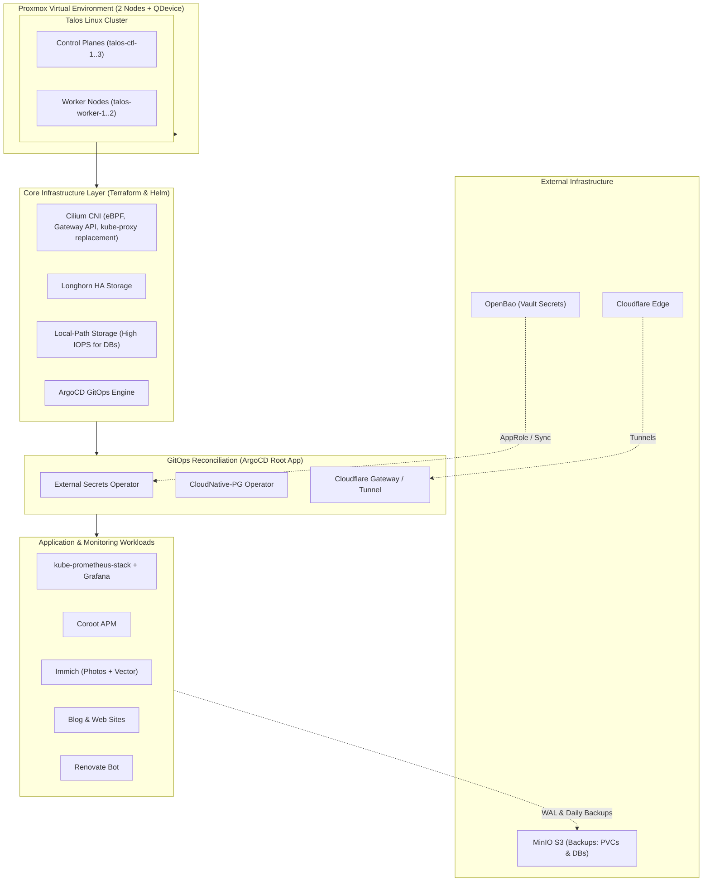
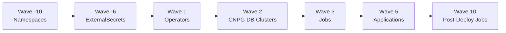

# 🏗️ Talos & KubeSpan Proxmox Homelab

[](https://www.talos.dev/)
[](https://kubernetes.io/)
[](https://argo-cd.readthedocs.io/)
[](https://cilium.io/)
[](https://longhorn.io/)
[](https://cloudnative-pg.io/)
[](https://www.terraform.io/)
[](https://openbao.org/)

A fully automated, declarative, production-grade Kubernetes homelab running on Proxmox VE. Infrastructure is bootstrapped using **Terraform** and **Talos Linux**, interconnected with **KubeSpan**, networked with **Cilium (eBPF)**, backed by **Longhorn** and **Local-Path** storage, secured with **OpenBao** and **External Secrets Operator (ESO)**, and continuously reconciled via **ArgoCD (GitOps)**.

---

## 📑 Table of Contents

- [Architecture Overview](#-architecture-overview)
- [Repository Structure](#-repository-structure)
- [Storage Strategy](#-storage-strategy)
- [Node Topology & Hardware](#-node-topology--hardware)
- [Prerequisites](#-prerequisites)
- [Bootstrap & Deployment Guide](#-bootstrap--deployment-guide)
  - [1. Terraform Infrastructure Provisioning](#1-terraform-infrastructure-provisioning)
  - [2. Kubeconfig & Cluster Access](#2-kubeconfig--cluster-access)
  - [3. ArgoCD Access & GitOps Handover](#3-argocd-access--gitops-handover)
  - [4. Cloudflare & Service Secrets Setup](#4-cloudflare--service-secrets-setup)
- [Secrets Management (OpenBao + ESO)](#-secrets-management-openbao--eso)
- [ArgoCD Sync Wave Architecture](#-argocd-sync-wave-architecture)
- [Observability & Monitoring Stack](#-observability--monitoring-stack)
- [Database Management & Disaster Recovery](#-database-management--disaster-recovery)
- [Roadmap & Future Plans](#-roadmap--future-plans)

---

## 🏛 Architecture Overview



### Design Principles
- **Immutable OS**: Talos Linux provides a minimal, API-driven, security-hardened Linux kernel with zero SSH access.
- **GitOps Driven**: All manifests live declaratively in git. ArgoCD continuously syncs configuration from the `HEAD` of this repository.
- **Zero Secrets in Git**: Secrets are stored in OpenBao. External Secrets Operator (ESO) syncs Kubernetes Secrets dynamically at deploy time.
- **High Availability & Separation of Concerns**: Clustered control planes and multi-replica worker nodes, dedicated local storage for relational databases, and distributed storage for dynamic stateful workloads.

---

## 📂 Repository Structure

```text
Talos-KubeSpan-Homelab/
├── .talos/                      # Talos machine configuration patches
│   └── patches/                 # VIP, KubeSpan, NetBird, ctl, and worker patches
├── terraform/                   # IaC bootstrap for Proxmox VMs & initial cluster setup
│   ├── main.tf                  # Proxmox VMs, Talos bootstrap, Cilium, Longhorn, ArgoCD
│   ├── nodes.yaml               # Cluster node inventory (IPs, MACs, roles, specs)
│   └── examplevars.tfvars       # Template variable file
├── infrastructure/              # Base infrastructure manifests & environment overlays
│   ├── base/
│   │   ├── argocd/              # ArgoCD Helm chart & kustomization
│   │   ├── cfgate/              # Cloudflare Tunnel gateway & ExternalSecret
│   │   ├── cilium/              # Cilium Helm chart, IP pools, and Gateway API
│   │   ├── cnpg-operator/       # CloudNative-PG Operator Helm chart
│   │   ├── eso/                 # External Secrets Operator Helm chart & OpenBao store
│   │   ├── local-path/          # Local-path provisioner for DB storage
│   │   ├── longhorn/            # Longhorn Helm chart, RBAC, and scheduling
│   │   └── renovate/            # Renovate Bot CronJob & ExternalSecret
│   └── staging/                 # Staging environment overlay
├── apps/                        # Application workloads managed via GitOps
│   ├── base/
│   │   ├── authentik/           # Authentik SSO & PostgreSQL CNPG Cluster
│   │   ├── backup/              # Global ScheduledBackup & Longhorn RecurringJobs
│   │   ├── blog-site/           # Personal blog & HTTPRoute
│   │   ├── ggprohn/             # Personal website & HTTPRoute
│   │   ├── immich/              # Immich Photo server + pgvector CNPG Cluster
│   │   └── minecraft-server/    # Dedicated game server
│   └── staging/                 # Staging application overlay
├── monitoring/                  # Observability and metrics stack
│   ├── base/
│   │   ├── coroot/              # Coroot eBPF collector and Coroot-db CNPG cluster
│   │   └── grafana-stack/       # kube-prometheus-stack, Grafana, & CNPG grafana-db
│   └── staging/                 # Staging monitoring overlay
└── clusters/                    # ArgoCD root application bootstrapping
    └── homelab-cluster/
        └── argocd/bootstrap/    # root-app.yaml (App-of-Apps)
```

---

## 💾 Storage Strategy

Storage workloads are partitioned based on performance and resilience requirements:

| Storage Class | Backing Engine | Primary Use Case | Target Workloads |
| :--- | :--- | :--- | :--- |
| **`local-path`** | Local Node NVMe/SSD | High IOPS, low-latency relational databases where clustering/replication is handled natively by the application operator. | **CloudNative-PG** |
| **`longhorn`** | Distributed Block Storage | Resilient multi-replica shared storage with snapshotting and automated S3 backups. | **Prometheus**, **Alertmanager**, Immich media PVCs, stateful workloads |

---

## 🖥 Node Topology & Hardware

Nodes are defined in [`terraform/nodes.yaml`]:

| Node | Role | IP Address | Cores | RAM | Primary Disk |
| :--- | :--- | :--- | :--- | :--- | :--- |
| `talos-ctl-1` | Control Plane | `192.168.2.10` | 4 vCPU | 6 GB | 50 GB |
| `talos-ctl-2` | Control Plane | `192.168.2.11` | 4 vCPU | 6 GB | 50 GB |
| `talos-ctl-3` | Control Plane | `192.168.2.12` | 4 vCPU | 6 GB | 50 GB |
| `talos-worker-1` | Worker | `192.168.2.20` | 6 vCPU | 16 GB | 200 GB |
| `talos-worker-2` | Worker | `192.168.2.21` | 6 vCPU | 16 GB | 200 GB |

---

## 📋 Prerequisites

Before bootstrapping the cluster, ensure the following are available:
1. **Proxmox VE Cluster**: Running Proxmox VE with API token permissions to create VMs and allocate disks on the designated storage pool (e.g. `ssd-pool`).
2. **MinIO / S3 Object Store**: S3-compatible bucket for backups:
   - `s3://database-backup` (PostgreSQL WAL archiving & CNPG base backups)
   - `s3://pvc-store` / `s3://pvc-backup` (Longhorn snapshots & volume backups)
3. **OpenBao / HashiCorp Vault**: External Vault server configured with AppRole authentication.
4. **GitHub PAT**: Token with repository read access for ArgoCD private repo synchronization.
5. **Tools**: `terraform`, `talosctl`, and `kubectl`.

---

## 🚀 Bootstrap & Deployment Guide

### 1. Terraform Infrastructure Provisioning

Terraform provisions the Proxmox VMs, installs Talos Linux, bootstraps etcd, and initializes core networking (Cilium) and storage (Longhorn) before handing off to ArgoCD.

```bash
cd terraform

# 1. Create your variables file from the template
cp examplevars.tfvars terraform.tfvars

# 2. Fill in Proxmox API, S3 endpoints, and GitHub tokens
vi terraform.tfvars

# 3. Initialize and provision
terraform init
terraform apply
```

### 2. Kubeconfig & Cluster Access

Once Terraform completes the bootstrap, export your cluster kubeconfig:

```bash
terraform output -raw kubeconfig > kubeconfig.yaml
export KUBECONFIG="$(pwd)/kubeconfig.yaml"

# Verify cluster connectivity
kubectl get nodes -o wide
```

### 3. ArgoCD Access & GitOps Handover

ArgoCD is installed during the Terraform bootstrap and automatically reconciles the root application [`clusters/homelab-cluster/argocd/bootstrap/root-app.yaml`].

Retrieve the initial ArgoCD admin password:

```bash
kubectl -n argocd-system get secret argocd-initial-admin-secret \
  -o jsonpath="{.data.password}" | base64 -d; echo
```

Port-forward or access the ArgoCD web interface via its Cilium LoadBalancer IP (`192.168.2.206:80`, change this value in `infrastructure/base/argocd/argocd-values`).

---

## 🔐 Secrets Management (OpenBao + ESO)

This homelab follows GitOps best practices: **No plaintext secrets are ever committed to git.** Kubernetes `ExternalSecret` manifests act as pointers to secrets stored securely in OpenBao.

### OpenBao Cluster Permissions and Bootstrap

```bash
# 1. Enable the KV v2 secrets engine
bao secrets enable -path=secret kv-v2

# 2. Store Grafana credentials
bao kv put secret/staging/grafana \
  admin-user=admin \
  admin-password="$(openssl rand -base64 24)"

# 3. Store Cloudflare Tunnel credentials
bao kv put secret/staging/cloudflare \
  token="<CLOUDFLARE_API_TOKEN>"

# 4. Store Renovate Bot GitHub Token
bao kv put secret/staging/renovate \
  github-token="ghp_your_github_token"

# 5. Create a read-only policy for ESO
bao policy write eso-read - <<'POL'
path "secret/data/staging/*"     { capabilities = ["read"] }
path "secret/metadata/staging/*" { capabilities = ["read", "list"] }
POL

# 6. Enable and configure AppRole authentication
bao auth enable approle
bao write auth/approle/role/eso \
  token_policies=eso-read \
  token_ttl=1h \
  token_max_ttl=4h \
  secret_id_ttl=0 \
  token_bound_cidrs=192.168.70.210,192.168.70.211,192.168.70.244

#Caddy node IP's and the VIP for Caddy, or put your cluster CIDR like 192.168.0.0/24

# 7. Extract Role ID and generate a Secret ID
ROLE_ID=$(bao read -field=role_id auth/approle/role/eso/role-id)
SECRET_ID=$(bao write -f -field=secret_id auth/approle/role/eso/secret-id)

# 8. Inject the AppRole Secret ID into the external-secrets namespace
kubectl -n external-secrets create secret generic openbao-approle \
  --from-literal=secret-id="$SECRET_ID"
```

Verify that [`infrastructure/base/eso/clustersecretstore-openbao.yaml`] has the matching `roleId`, if you completed the above do `echo $ROLE_ID`.

---

## 🌊 ArgoCD Sync Wave Architecture

ArgoCD synchronizes manifests in deterministic waves to ensure dependency ordering across namespaces, credentials, databases, and services:



| Wave | Phase | Target Resources | Description |
| :---: | :--- | :--- | :--- |
| **`-10`** | Namespaces | `Namespace` manifests  | Creates target namespaces before workload deployment. |
| **`-6`** | Secrets | `ExternalSecret` manifests  | Pulls secrets from OpenBao into K8s Secrets before pods start. |
| **`1`** | Operators | CloudNative-PG, Longhorn, ESO | Installs Custom Resource Definitions and controller operators. |
| **`2`** | Databases | CNPG `Cluster` | Provisions HA PostgreSQL clusters and initializes Barman S3 replication. |
| **`3`** | Jobs to be completed before application runtime | `Job` | RBAC-scoped sync jobs copying generated CNPG app credentials to service namespaces. |
| **`5`** | Workloads | Grafana, Prometheus, Authentik, Immich, Websites, Renovate | Applications start up with database connectivity and secrets ready. |
| **`10`** | Post-Sync | Housekeeping & validation | Post-application health verifications and backup verifications. |

---

## 📊 Observability & Monitoring Stack

The observability stack lives under [`monitoring/base/grafana-stack/`] and [`monitoring/base/coroot/`]. I will transition over to Grafana-stack only, but I liked coroot so far and found it useful.

### Dedicated Service LoadBalancer IPs (Cilium IPAM)

Services are allocated dedicated LAN IPs from the Cilium `local-pool` for direct homelab access:

| Service | LoadBalancer IP | Port | Description |
| :--- | :--- | :--- | :--- |
| **ArgoCD** | `192.168.2.206` | `80` / `443` | GitOps UI & API |
| **Grafana** | `192.168.2.230` | `80` | Dashboards & visualization |
| **Prometheus** | `192.168.2.231` | `9090` | Prometheus server & query API |
| **Local Gateway** | `192.168.2.240` | `80` / `443` | Cilium Gateway API ingress |

---

## 🗄 Database Management & Disaster Recovery

### CNPG Init vs Restore Workflow

For each database (`immich-db`, `authentik-db`, `coroot-db`, and `grafana-db`), manifests follow a structured lifecycle:

1. **Initial Bootstrap (`*.init` / active manifest)**:
   - File: [`grafana-db.yaml`]
   - Uses `bootstrap.initdb` to create a fresh PostgreSQL cluster.
   - Configures continuous WAL archiving to MinIO S3 (`s3://database-backup/grafana-db`).
2. **Disaster Recovery / Migration (`*.restore`)**:
   - File: [`grafana-db.yaml.restore`]
   - Uses `bootstrap.recovery` from `externalClusters` pointing to the Barman S3 backup.
   - Re-attaches to the existing WAL stream and restores to the latest transaction log.

#### Restoring a Database from Backup
To restore Grafana (or any database) from an existing S3 backup:
1. Replace `grafana-db.yaml` with the contents of `grafana-db.yaml.restore`.
2. Commit and push the changes to GitHub.
3. ArgoCD syncs the manifest; CloudNative-PG boots from the S3 object store and replays WAL archives.

### Scheduled S3 Backups

Centralized in [`apps/base/backup/global-backup.yaml`]:
- **Longhorn PVCs**: Daily snapshots and S3 backup retention (14 days).
- **CNPG ScheduledBackups**:
  - `00:00 UTC` - `coroot-db`
  - `00:10 UTC` - `immich-db`
  - `00:20 UTC` - `authentik-db`
  - `01:00 UTC` - `grafana-db`

---

## 🔮 Roadmap & Future Plans

- [ ] **Talos In-Place Rolling Upgrades**: Test non-disruptive OS upgrades from Talos v1.12.x to v1.13.x, have a bash script for this.
- [ ] **DevContainers**: Standardized development environments for homelab services.
